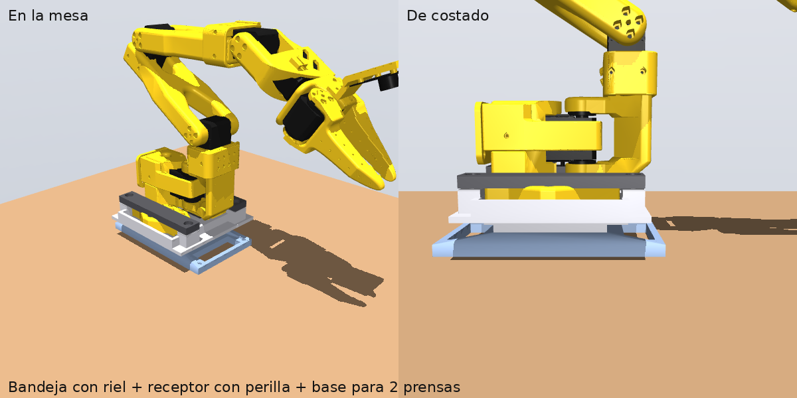
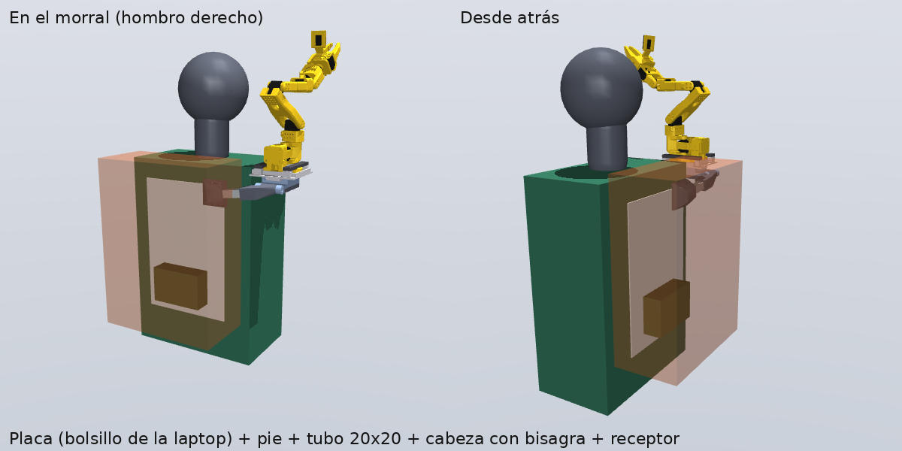
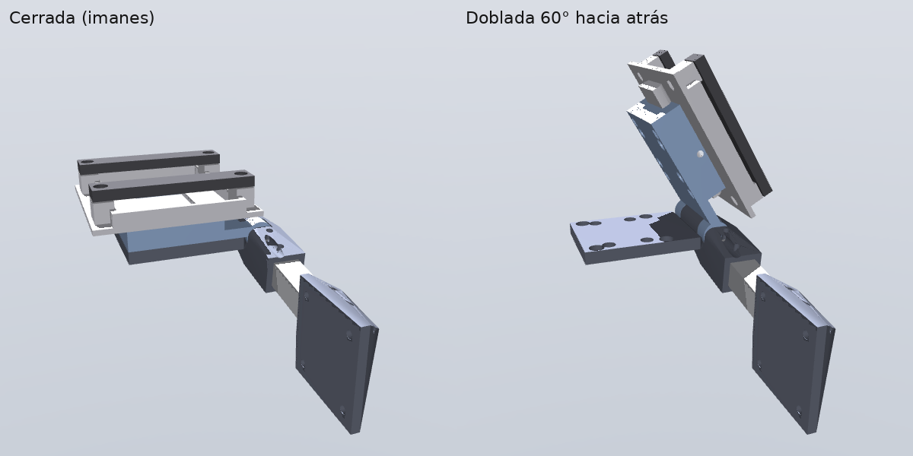

# Soporte del brazo SO-101: mesa y morral (OpenSCAD)

Un solo tipo de unión para todo: la base del brazo va en una **bandeja con riel cola de milano
de 38 mm** (tipo Arca), y el riel entra en un **receptor** con perilla. El receptor está en la
base de mesa y en la cabeza del soporte del morral: el brazo se pasa de uno a otro en segundos,
sin herramientas.





## Piezas para imprimir

PETG, capa 0.2 mm, **6 perímetros, 40 % de relleno** (giroide). Holgura `CL = 0.4 mm` en
`params.scad` (bajarla a 0.3 si la impresora es precisa).

| Pieza | Para | Masa aprox. | Notas de impresión |
|---|---|---|---|
| `bandeja` | todo | 77 g | abraza la pestaña de la base (87 x 111 mm); riel abajo; tuercas M5 atrapadas |
| `barra` (x2) | todo | 25 g | aprietan las alas de la pestaña (con goma o TPU de 1 mm debajo) |
| `receptor` | mesa | 37 g | mordaza fija + bolsillo de la móvil + tope al fondo |
| `mordaza`, `perilla` | mesa y morral | 7 g | la mordaza la empuja un tornillo M5 con perilla |
| `base_mesa` | mesa | 69 g | alas para dos prensas en C, o 4 tornillos a la mesa |
| `pie_mastil` | morral | 59 g | atornillado a la placa de la espalda, arriba a la derecha |
| `cabeza_fija` | morral | 81 g | toma el tubo; nudillo central de la bisagra; apoyo con imanes y tope |
| `cabeza_movil` | morral | 78 g | lleva el receptor; nudillos laterales; imanes |
| `caja`, `tapa` | morral | 88 g | Orange Pi 5 Pro, batería 3S, convertidor 5 V, relé de parada |
| `probeta_riel`, `probeta_receptor` | prueba | 19 g | **imprimir primero**: 2 cm del riel y del receptor para ajustar la holgura |

`placa_espalda.dxf`: contorno para cortar la placa de **HDPE de 3 mm** (o polipropileno; una
tabla de picar sirve) de 250 x 380 mm, con ventanas para alivianar (~190 g). Entra en el
bolsillo de la laptop de casi cualquier morral.

## Para comprar

| Cant. | Qué | Notas |
|---|---|---|
| 1 | Tubo cuadrado de aluminio 20 x 20 x 1.5 mm | cortar a **142 mm** |
| 1 | Placa de HDPE o PP de 3 mm, 25 x 38 cm | se corta con cúter o sierra |
| 8 | Imanes de neodimio N52, 10 x 5 mm | 4 pares; se pegan con epoxi en los huecos |
| 1 | Tornillo M8 x 70 + tuerca autoblocante + 2 arandelas de nylon | pasador de la bisagra (las arandelas dan la fricción) |
| ~16 | Tornillos M5 (12, 16, 25 y 30 mm) + tuercas + arandelas | barras, receptor, pie, pasadores del tubo, perilla |
| 1 | Tornillo M4 x 10 | seguridad: entra en la ranura del riel para que no se deslice |
| 2 | Prensas en C | para la mesa |
| 1 | Sensor de efecto Hall (A3144 o similar) | en la bisagra: detecta si se dobló |
| 1 | Botón de parada de emergencia (hongo, con enclavamiento) + relé o MOSFET | en la correa del hombro: corta la alimentación de los servos |

## Cómo es estable, seguro y cómodo

**Estable**
- La carga no cuelga de la tela: va a una **placa rígida** en la espalda y de ahí al cinturón
  del morral. Correa de pecho y cinturón **ajustados**: en la simulación, un morral flojo
  duplica el error de la cámara (p90 de 8° a 19°).
- **Tubo de aluminio** 20 x 20 y bisagra con **tope rígido cara contra cara** (un tope blando
  hace que el brazo se bambolee al caminar).
- Lo pesado (batería, placa) va **abajo** en la caja; el brazo arriba a la derecha.

**Seguro**
- **Bisagra que se dobla hacia atrás** si el brazo se engancha: los imanes la sostienen con
  ~7 N·m (el caminar normal le pide ~1 N·m) y ceden en un golpe. Nunca se dobla hacia la cabeza:
  hacia adelante la frena el apoyo. En la simulación, contra una rama a 1.74 m, el brazo recibe
  **6 veces menos golpe** (39 N contra 248 N) y el hombro **menos de la mitad** (106 N contra
  262 N) que con un soporte rígido. Se vuelve a cerrar a mano.
- **Sensor Hall en la bisagra** (usa los mismos imanes): si se dobla, el robot se detiene.
- **Botón de parada** en la correa, que corta la alimentación de los servos (no solo el software).
- **Límites en la memoria de cada servo** (ángulos y torque máximo ~50 %): siguen activos aunque
  falle el programa. La base no puede girar hacia la cabeza.
- **Tornillo de seguridad** en el riel: aunque se afloje la perilla, el brazo no se sale.
- Batería en bolsa ignífuga, con BMS y fusible; cables por dentro del tubo.

**Cómodo**
- Peso agregado ~1.5 kg (brazo 650 g, soporte ~450 g, placa ~190 g, electrónica ~250 g), casi
  todo sobre la cadera.
- El brazo queda en el borde del hombro, a 26 cm del centro de la cabeza, y la cámara a ~1.78 m:
  no tapa la vista.
- El tubo sale por arriba del morral (por el cierre o un ojal). Placa curva/acolchada contra la
  espalda (el bolsillo de la laptop ya suele estarlo).

## Medidas (las usa la simulación)

`params.scad` es la única fuente. `../sim/backpack.py` copia las del morral (bisagra, tubo,
torque de los imanes) y la prueba `test_cad_and_sim_agree` verifica que coincidan.

| Qué | Valor |
|---|---|
| Base del brazo respecto del centro de los hombros | 10 cm atrás, 26 cm a la derecha, a la altura de los hombros |
| Bisagra respecto de la base del brazo | 4.9 cm atrás, 3.1 cm abajo |
| Torque de los imanes | 7 N·m cerrada; a ~3° abierta cae a un tercio |
| Carga máxima medida caminando (soporte → usuario, con el morral) | ~17 N·m, ~82 N |

## Flujo de trabajo

```bash
./export.sh                          # piezas -> stl/ y placa_espalda.dxf
MUJOCO_GL=osmesa python render.py    # imágenes en ../media/
```

**Antes de imprimir todo:** la base del SO-101 se midió del modelo 3D oficial (MuJoCo
Menagerie); medir la base real con un calibre y ajustar `BASE_*` si difiere. Imprimir las
probetas y probar el ajuste del riel (y con una pinza Arca comercial, si se quiere usar una).
