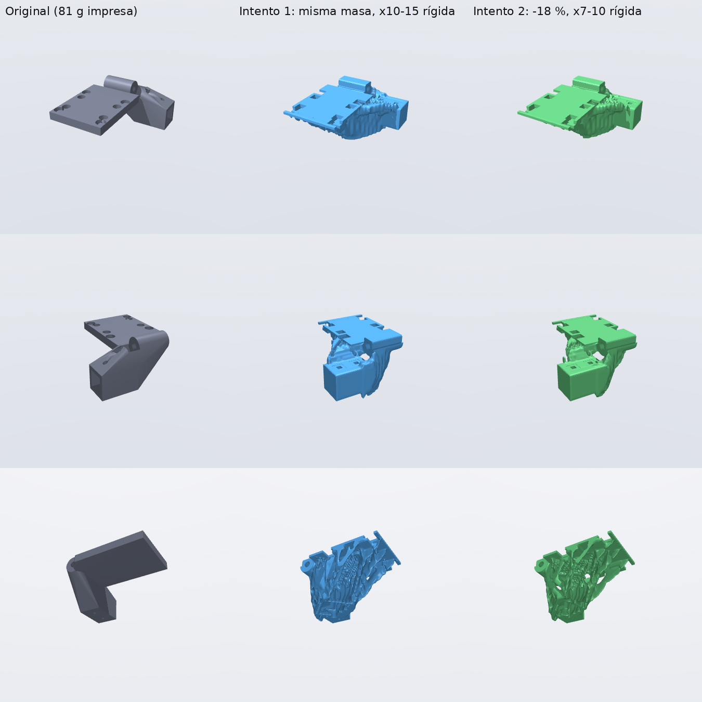

# Prueba de diseño generativo: cabeza fija del soporte del morral

Prueba con la skill de diseño generativo (optimización topológica con PyTopo3D + acabado en
Blender) sobre una sola pieza, la `cabeza_fija`, para ver si conviene usarla en el soporte.

## Resultado

| | Original | Intento 1 (misma masa) | Intento 2 (menos material) |
|---|---|---|---|
| Volumen (masa maciza en PETG) | 132 cm³ (168 g) | 134 cm³ (171 g, +2 %) | 109 cm³ (138 g, −18 %) |
| **Impresa con 6 perímetros + 40 % de relleno** (estimado) | **~125 g** | ~163 g | **~136 g (+9 %)** |
| Rigidez: caminar con 500 g | 1 | ×14.7 | ×10.0 |
| Rigidez: caminar con empuje a la izquierda / derecha | 1 | ×12.2 / ×10.5 | ×8.4 / ×6.7 |
| Rigidez: rama | 1 | ×11.0 | ×7.5 |
| Rigidez: imanes a punto de ceder | 1 | ×14.2 | ×8.8 |
| Esfuerzo indicativo (p99) | 1 | ×0.16–0.20 | ×0.24–0.31 |
| Superficie que pide soporte al imprimir | 10 cm² | 97 cm² | 78 cm² |

**Veredicto: no adoptar la pieza generativa.** En el papel (pieza maciza) es más rígida y más
liviana; impresa con relleno, como se imprimen de verdad, pesa lo mismo o más (sus ramas delgadas
son casi todo perímetro) y necesita ~8 veces más soporte. Lo que sí deja claro: **la original es
floja** (la plataforma de los imanes es una placa de 10 mm que cuelga de la bisagra) y la rigidez
sale de un **alma profunda bajo la plataforma** que la une con el encastre del tubo. Eso se puede
dibujar a mano en la pieza original (nervios), sin soportes y sin perder lo editable.

## Supuestos y límites

- **Cargas** (de la simulación del morral, `arm/sim/demo_walk.py`, con 1.5 de margen): caminar
  sosteniendo 500 g (24 N a 206 mm adelante de la base del brazo), lo mismo con empuje lateral a
  cada lado, la rama (20 N hacia atrás en la pinza: lo máximo antes de que cedan los imanes) y los
  imanes a punto de ceder (100 N contra el pasador). Detalle en `problems.py`.
- **Tubo horizontal**: para la prueba, el tubo es paralelo al pasador (en el diseño sube 15 mm);
  la original de comparación es la misma pieza con ese cambio (`head_fixed_level.scad`).
- **Lugar**: se le permitió crecer 1.1 cm más abajo que la original (y 1 cm más atrás); habría que
  confirmar que ese espacio está libre detrás del hombro.
- La rigidez y el esfuerzo son **cocientes en un modelo de vóxeles de 3 mm** (las dos piezas
  macizas), no factores de seguridad. La masa impresa es una estimación (vóxeles de 0.5 mm).
- La limpieza corrió en una grilla de 0.5 mm en vez de 0.25 mm (con 0.25 mm no alcanzaba la memoria
  de 16 GB para una pieza de 13 x 7 x 11 cm).
- No se probó: impresión real, la orientación de impresión ideal, las otras piezas del soporte.

## Archivos

- `problems.py`: el problema (marco, zonas prohibidas, piezas obligatorias, cargas).
- `head_fixed_level.scad` → `baselines/cabeza_fija.stl`: la original de comparación.
- `comparacion.png`: original e intentos. Las mallas de los intentos quedan fuera del repo.
