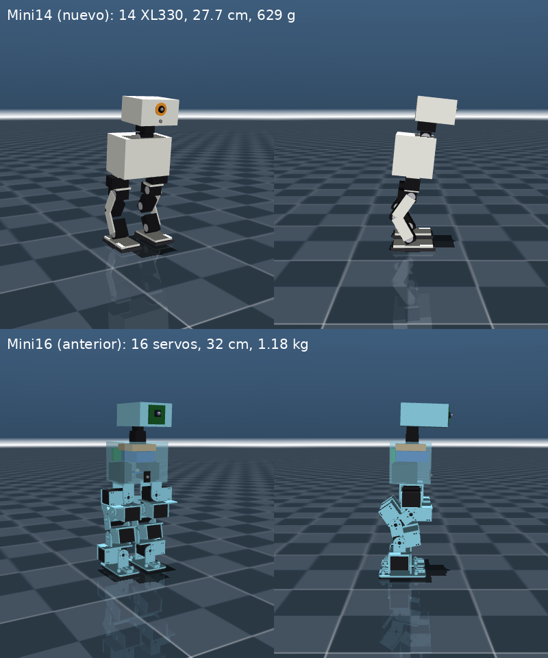

# Mini14: diseño nuevo con lo aprendido del Microduck

Diseño desde cero siguiendo [LECCIONES.md](LECCIONES.md): servos chicos, 5 por pierna, cabeza
pesada como contrapeso y equilibrio a cargo de la IA. El modelo se genera con
`model/build_mini14.py` (todas las medidas en un solo lugar).

| | Microduck | **Mini14** | Mini16 (anterior) |
|---|---|---|---|
| Servos | 14 XL330 (+ pico) | **14 XL330-M288-T** | 12 STS3215 + 4 SCS0009 |
| Por pierna | 5 | **5** (sin tobillo roll) | 6 |
| Cuello/cabeza | 4 | **4** (cuello pitch, cabeza pitch, yaw, roll) | 4 |
| Altura | ~25 cm | **27.7 cm** | 32 cm |
| Masa | 737 g (modelo) | **629 g** | 1182 g |
| Peso en piernas | 35 % | **41 %** | 62 % |
| Peso en cuello + cabeza | 38 % | **32 %** | 8 % |
| Cadera pitch sobre el piso | 10 cm | **10 cm** | 12 cm |

## Decisiones

- **Batería en la cabeza** (2x 18650 + BMS 2S, 104 g): le da a la cabeza la masa que el Microduck
  usa como contrapeso, sin agregar peso muerto. Los cables pasan por el cuello.
- **Orange Pi Zero 3 en el torso**, de pie contra la espalda, para que el torso quede bajo.
- **Cámara USB y ToF 8x8 al frente de la cabeza** (como el Microduck): miran a donde mira la cabeza.
- **4 sensores de pisada** (punta y talón de cada pie), ya están en el modelo.
- **Pie de 80 x 42 mm** con suela plana de TPU.

## Servos: XL330 a 7.4 V

El modelo usa los parámetros que el proyecto [BAM](https://github.com/Rhoban/bam) midió en un
XL330 real (`params/xl330/m6.json`): torque máximo ~1.0 N·m a 7.4 V, rigidez con la ganancia de
fábrica (P = 400) de ~1.2 N·m/rad, freno por fuerza contraelectromotriz y fricción.

Son **blandos**: con el peso del robot, las rodillas ceden ~5°. Por eso una caminata fija no
alcanza (casi no avanza y no mantiene el rumbo) y el equilibrio lo hace la IA, igual que en el
Microduck. La caminata de referencia solo da pasos sin caerse, corrigiendo la inclinación con el
tobillo.

**Ojo con el voltaje:** la hoja de datos del XL330 dice 3.7–6 V, pero el Microduck los alimenta
directo con 2S (simula 6.5–8.2 V). Es un riesgo conocido: más torque y velocidad a cambio de
vida útil. La alternativa segura es un regulador de 6 V / 5 A (con menos torque).

## Componentes

| Cant. | Componente | Masa | Precio aprox. | Notas |
|---|---|---|---|---|
| 14 | Dynamixel **XL330-M288-T** | 18 g c/u | ~24 USD c/u | 20 x 34 x 26 mm, bus TTL, cables en cadena |
| 1 | **U2D2** (o circuito semidúplex con 74LVC2G241) | 9 g | ~32 USD | USB ↔ bus Dynamixel |
| 1 | **Orange Pi Zero 3** | 25 g | ya la tienes | 50 Hz de control sobra |
| 2 | 18650 alta descarga (Molicel P30B) + soporte + BMS 2S | 104 g | ~25 € | en la cabeza |
| 1 | UBEC 5 V / 3 A | 10 g | ~4 € | para la Orange Pi |
| 1 | IMU **BNO055** | 3 g | | en el torso |
| 1 | ToF **VL53L5CX** | 2 g | 15–25 € | en la cabeza |
| 1 | Cámara USB compacta | 6 g | 10–20 € | en la cabeza |
| 4 | Microinterruptores SS-10 | 1 g c/u | ~1 € c/u | punta y talón |
| — | Condensador 1000 µF, interruptor, XT30, cables | ~20 g | ~10 € | |

**Total aproximado:** ~420 € (los servos son ~80 %). Más caro que Mini16 por servo, pero más
liviano y con un diseño que ya funciona a este tamaño.

## Pesos (modelo)

| Grupo | Masa |
|---|---|
| 14 XL330 | 252 g |
| Batería + soporte + BMS (cabeza) | 104 g |
| Electrónica del torso | 70 g |
| Sensores de la cabeza | 8 g |
| Plástico (torso 45 g, cabeza 30 g, piernas 112 g, cuello 8 g) | 195 g |
| **Total** | **629 g** |

## Resultado con IA

Entrenamiento corto (2 M de pasos, 23 min en CPU, piso plano). La IA mueve las 10 articulaciones
de las piernas y las 4 de la cabeza. Evaluado en 20 pruebas con variaciones aleatorias y empujones:

| | Caminata de referencia | Con IA |
|---|---|---|
| Pruebas sin caerse y avanzando ≥ 30 cm | 0 % | **100 %** |
| Avance medio en 10 s | −1 cm | **72 cm** (~7 cm/s) |

Video: [media/mini14_ia_plano.mp4](media/mini14_ia_plano.mp4). Política: `rl/policies/mini14_flat.onnx`.

## Pendiente

- Entrenar con rampas, escalones y órdenes de giro (más largo: conviene la PC con NVIDIA).
- Diseñar las piezas en OpenSCAD con las medidas reales del XL330, como se hizo con Mini16, y
  volver a generar el modelo desde el CAD.
- Medir un XL330 real con BAM (o usar sus parámetros publicados) antes de pasar al robot.
