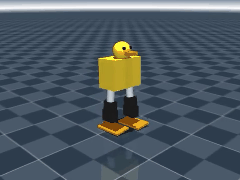

# Biped6 — bípedo pequeño de 6 servos (simulación MuJoCo)

Bípedo tipo "pato" de **~26 cm y ~0.8 kg**, con **6 servos Feetech STS3215 (7.4 V)**.



Esta primera versión es solo la **simulación**: modelo físico + una caminata
programada que ya funciona. La IA entrenada y las piezas imprimibles vienen después.

> Proyecto independiente de Pip-Boy Otto; vive en esta carpeta solo de forma temporal.

## Diseño

```
        (cabeza)
      ┌──────────┐
      │  torso   │  baterías 2x18650, Raspberry Pi Zero 2W, IMU, placa de servos
      └─●──────●─┘  ← cadera pitch (x2), eje a 14.5 cm del piso
        │      │
        │      │    piernas rectas de 9 cm (sin rodilla)
        ■      ■    ← tobillo pitch (x2), a 5.5 cm
        ■      ■    ← tobillo roll  (x2), a 2.5 cm
      ▬▬▬▬    ▬▬▬▬  pies 9 x 5 cm con interruptor de contacto
```

| Articulación | Eje | Rango | Para qué sirve |
|---|---|---|---|
| Cadera pitch | adelante/atrás | ±60° | adelantar la pierna |
| Tobillo pitch | adelante/atrás | ±52° | mantener el pie plano |
| Tobillo roll | lado a lado | ±29° | inclinar el cuerpo y levantar el otro pie |

**Cómo camina:** los dos tobillos roll inclinan el cuerpo hacia un lado, lo que
levanta el pie contrario; la cadera adelanta ese pie mientras el tobillo pitch lo
mantiene paralelo al piso. Es el mismo principio de los robots "Otto DIY", pero
con servos que reportan su posición (necesario para entrenar con IA después).

**Sin rodillas** a propósito: con solo 6 servos, poner los motores en los tobillos
mantiene los pies planos en ambos ejes y deja el centro de masa bajo.

## Resultados en simulación (caminata programada, sin IA)

| Métrica | Valor |
|---|---|
| Velocidad | ~9 cm/s (105 cm en 12 s) |
| Desvío lateral | ~1 cm en 1 m |
| Altura de paso | ~0.8 cm |
| Inclinación máx. del torso | ~6° |
| Torque máx. usado | ~0.7 N·m de ~1.9 N·m disponibles (≈35 %) |
| Giro | sí, ambos lados (`--turn`) |

Se probó también con piso resbaloso (fricción 0.5), piso pegajoso (1.3),
+150 g de peso y servos más blandos/duros (kp 5–12): no se cae en ningún caso.

## Uso

```bash
cd biped
pip install -r requirements.txt
cd sim
python run_demo.py                 # simula e imprime resultados
python run_demo.py --video pato.mp4  # graba video (en servidor: MUJOCO_GL=osmesa o egl)
python run_demo.py --viewer        # visor 3D interactivo (requiere pantalla)
python run_demo.py --turn 0.4      # gira a la izquierda
python -m pytest -q                # pruebas
```

Archivos:
- `model/biped6.xml` — el robot (medidas, masas, servos, IMU, sensores de pie)
- `model/scene.xml` — robot + piso
- `sim/gait.py` — caminata programada y sus parámetros
- `sim/common.py` — cargar modelo y simular
- `sim/run_demo.py` — demo / video / visor
- `sim/test_biped.py` — pruebas

## Lista de piezas estimada

Precios de referencia tomados del BOM de Open Duck Mini (pueden variar).

| Pieza | Cant. | Aprox. |
|---|---|---|
| Feetech STS3215 **7.4 V** (19 kg·cm) | 6 | 84 € |
| Raspberry Pi Zero 2W + microSD | 1 | 36 € |
| Placa Waveshare Bus Servo Adapter (A) | 1 | 5 € |
| IMU BNO055 (o clon) | 1 | 1–40 € |
| 2x 18650 + portapilas + BMS 2S + regulador 5 V + interruptor | 1 | 32 € |
| Cargador USB-C | 1 | 10 € |
| Interruptores de pie SS-10 | 2–4 | 2–4 € |
| Insertos M3, tornillos, PLA (~300 g), TPU para suelas | — | ~15 € |
| **Total** | | **~185–225 €** |

## Limitaciones (importante)

- Las ganancias de los servos (`kp`, `kv`, `armature`, fricción) son **estimadas**.
  Antes de pasar al robot real hay que medirlas con un servo real (p. ej. con
  [BAM](https://github.com/Rhoban/bam), como hace Open Duck).
- El paso es bajo (~0.8 cm): sirve para piso plano, no para alfombras gruesas.
- Las piernas no chocan entre sí en la simulación.
- La caminata es programada (no reacciona a empujones). Eso es lo que resolvería
  el entrenamiento con IA.

## Próximos pasos

1. **Entrenamiento con IA (RL):** entorno de entrenamiento sobre este modelo,
   usando la IMU y los sensores de pie, para que camine reaccionando a empujones.
2. **Piezas imprimibles:** torso, piernas, soportes de tobillo y pies en OpenSCAD
   con las mismas medidas del modelo.
3. **Software del robot:** correr la caminata (o la política entrenada) en la
   Raspberry Pi Zero 2W a 50 Hz.
