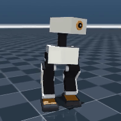
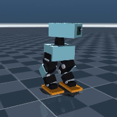

# Bípedos pequeños tipo Microduck — exploración en simulación (MuJoCo)

Exploración de diseño de un bípedo compacto de bajo costo, inspirado en Open Duck Mini v2
y Microduck. Hay dos variantes con el mismo código de simulación, caminata e IA:

| | **Mini13** | **Mini16** (por defecto, recomendado) |
|---|---|---|
| Motores | 13: 5 por pierna + 3 cabeza | 16: 6 por pierna + 4 cabeza |
| Pierna | cadera yaw/roll/pitch, rodilla, tobillo pitch | ídem + **tobillo roll** |
| Altura / masa | ~27 cm / 996 g | ~22.4 cm / 1.055 kg |
| Pie | suela curva de TPU (punta, talón, costados) | plano |
| Cámara | sí (simulada) | módulo tipo Raspberry Pi Camera Module 3 al frente de la cabeza |
| Velocidad en plano (caminata programada) | ~5 cm/s | ~4 cm/s |
| Rampas 10–15° (caminata programada) | no | **sí** |
| Escalones ≥ 1 cm | no (necesita IA) | no (necesita IA) |

<p>


</p>

Videos: [Mini13 caminando](media/mini13_walk.mp4) · [Mini13 girando](media/mini13_turn.mp4) ·
[Mini16 caminando](media/mini16_walk.mp4) · [Mini16 girando](media/mini16_turn.mp4) ·
[Mini16: lo que ve la cámara](media/mini16_camara.mp4)

> Proyecto independiente de Pip-Boy Otto; vive en esta carpeta solo de forma temporal.

## Conclusiones de la exploración

- **Piernas cortas y rodilla hacia atrás** caminan mucho más estable que piernas largas o rectas.
- **Sin tobillo roll (5 motores por pierna, como Open Duck):** al cargar el peso en una pierna el
  pie se inclina, así que la caminata programada solo puede levantar el pie ~1 cm. Camina bien en
  plano, pero cualquier borde (rampa o escalón de 3–5 mm) lo desestabiliza. Para terreno irregular
  depende de entrenamiento con IA, que es justo lo que hacen Open Duck y Microduck.
- **Con tobillo roll (6 por pierna):** levanta el pie 2 cm y sube rampas de 10–15° sin IA. Cuesta
  2 servos y ~100 g más.
- **Cintura roll** en vez de tobillo: ayuda poco (solo ~30 % del peso está arriba de ella).
- **Escalones de 1 cm o más:** ninguna caminata fija los pasa; hay que reaccionar al borde (IA +
  sensor de distancia mirando al piso).
- **Control de rumbo con la IMU** (BNO055): necesario en Mini13, cuyo rumbo en lazo abierto es
  caótico. Con él camina recto (balanceo de ±15–20°) y gira a la velocidad pedida.
- **IA:** el entorno de entrenamiento funciona de punta a punta (incluida la exportación a ONNX),
  pero los entrenamientos cortos (0.5 M pasos, ~8 min en CPU) apenas mejoran: un resultado real
  requiere entrenar mucho más, idealmente en GPU.

Todas las pruebas respetan los límites del STS3215 (torque percentil 99 < 1.3 N·m de 1.9 N·m,
velocidad pedida < 4.5 rad/s) y resisten fricción 0.5–1.3, +150 g y servos más blandos o rígidos.

## Diseño de Mini13 (según la especificación del proyecto)

```
          ┌───────────┐
          │  cabeza ◉ │  cámara; cuello pitch + cabeza pitch + cabeza yaw
          └─────┬─────┘
            ┌───┸───┐
            │ torso │     batería 2S abajo, placa, IMU cerca del centro de masa
            └┬─────┬┘
     cadera  ●     ●      yaw + roll + pitch
            ╱       ╲     muslo 5.5 cm
     rodilla●       ●     hacia atrás, rango ~130°
             ╲     ╱      canilla 6 cm
     tobillo  ●   ●       pitch
            ◖▬▬▬◗ ◖▬▬▬◗   pie 8.6 x 5 cm, suela curva TPU, sensor de contacto
```

- Árbol de cuerpos `torso → hip_yaw_link → hip_roll_link → thigh → shin → foot`, con el origen de
  cada cuerpo en el eje real del servo (compatible con onshape-to-robot).
- Cada servo está modelado como pieza aparte con su masa real (55 g), no por densidad.
- Pendiente para la etapa de CAD: soportes de doble eje con rodamiento (683/MR105), insertos M3,
  paredes de 2 mm, holguras 0.3–0.4 mm, pasacables para el rango completo de la rodilla y
  rodamiento de empuje en la cadera yaw.

## Uso

```bash
cd biped
pip install -r requirements.txt
cd sim
python run_demo.py                      # Mini16: simula e imprime resultados
python run_demo.py --robot mini13       # Mini13 (5 motores por pierna)
python run_demo.py --video robot.mp4    # graba video (en servidor: MUJOCO_GL=osmesa o egl)
python run_demo.py --viewer             # visor 3D interactivo (requiere pantalla)
python run_demo.py --turn 0.2           # gira a la izquierda 0.2 rad/s (negativo = derecha)
python -m pytest -q                     # pruebas
```

Entrenamiento con IA (opcional; ver `rl/env.py` para observaciones, recompensas y variaciones):

```bash
pip install -r requirements-rl.txt
cd rl
python train.py --robot mini13 --steps 500000 --out runs/prueba
python evaluate.py --robot mini13 --policy runs/prueba/policy.zip
python export_onnx.py runs/prueba/policy.zip policy.onnx
```

Archivos:
- `model/mini13.xml`, `model/mini16.xml` — robots; `model/scene_*.xml` — robot + piso
- `sim/robots.py` — medidas y parámetros de caminata de cada robot
- `sim/gait.py` — caminata programada, cinemática inversa y control de rumbo
- `sim/common.py`, `sim/terrain.py` — simulación, métricas, rampas y escalones
- `rl/` — entorno Gymnasium, entrenamiento PPO, evaluación y exportación ONNX

## Placa para el robot

La red de la IA es chica (2 capas de 128): cualquier placa la corre a 50 Hz. El límite es el
tamaño del torso (~7 x 9 cm en Mini13).

| Placa | ¿Cabe? | Notas |
|---|---|---|
| Orange Pi Zero 3 / Zero 2 | sí | sin conector de cámara: usar cámara USB |
| Raspberry Pi Zero 2W | sí | la más fácil de meter; conector de cámara CSI |
| Orange Pi 5 Pro | no | potente, pero exige un torso más grande y más batería |

## Lista de piezas estimada (Mini13)

| Pieza | Cant. | Aprox. |
|---|---|---|
| Feetech STS3215 **7.4 V** (19 kg·cm) | 10 | 140 € |
| Micro servo de bus con lectura de posición (p. ej. SCS0009) | 3 | 20–30 € |
| Placa Waveshare Bus Servo Adapter (A) | 1 | 5 € |
| IMU BNO055 (o clon) | 1 | 1–40 € |
| Batería 2S (2x18650 alta descarga o NP-F550) + BMS + UBEC 5 V + interruptor + condensadores | 1 | 30–40 € |
| Cámara, interruptores de pie, insertos M3, rodamientos, PLA/PETG, TPU | — | ~30 € |
| **Total (sin placa)** | | **~225–285 €** |

Mini16 suma 2 STS3215 (~28 €) y 1 micro servo.

## Limitaciones

- Las ganancias de los servos son estimadas: hay que medirlas con un servo real (p. ej. con
  [BAM](https://github.com/Rhoban/bam)) antes de pasar al robot real.
- Las piernas no chocan entre sí en la simulación.
- Los pies y piezas son formas simples (cajas y cápsulas), no el CAD final.
