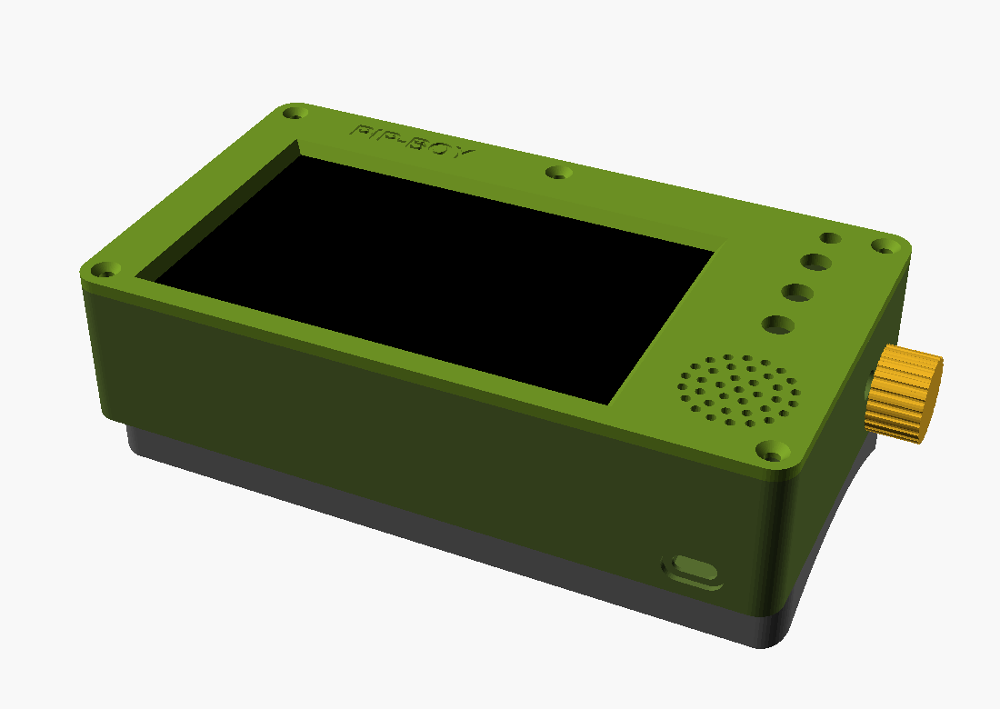
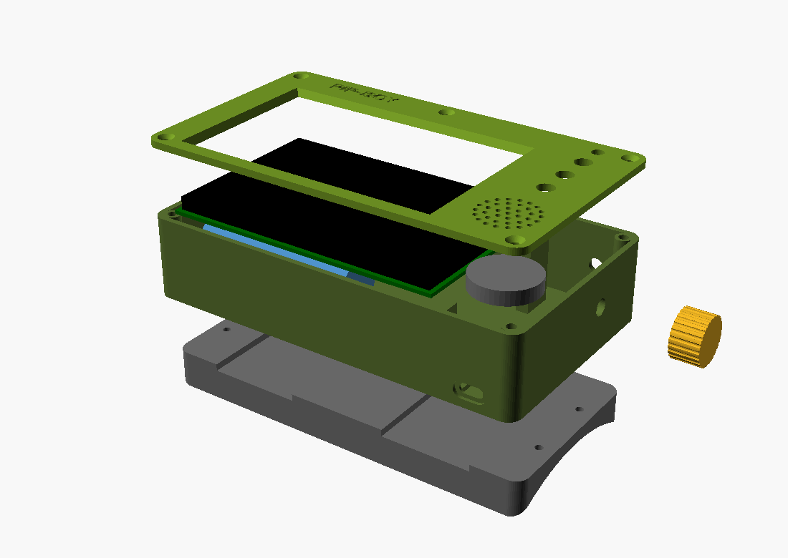
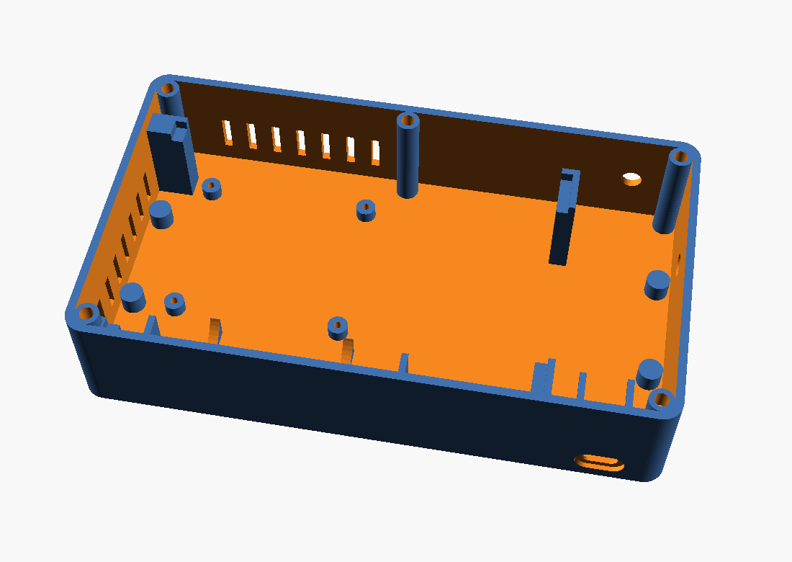
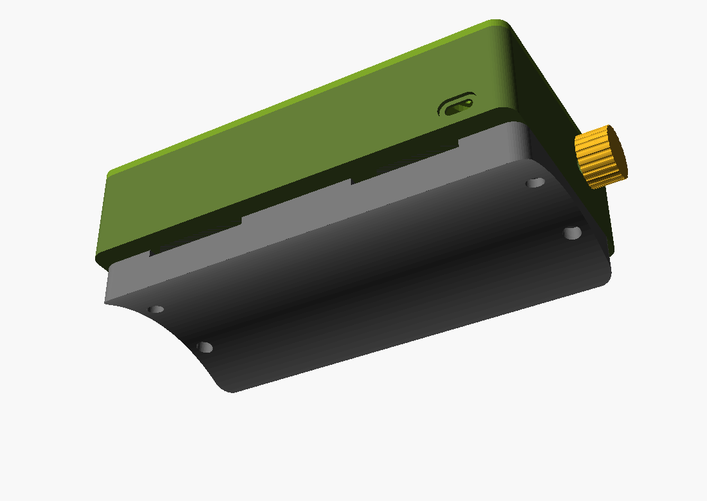

# Pip-Boy de muñeca: Orange Pi Zero 3 + pantalla HDMI de 5"

Carcasa imprimible en 3D, paramétrica, en [`cad/pipboy-zero3-v0.1.scad`](../cad/pipboy-zero3-v0.1.scad).
Es la **v0.1**: un primer bloque funcional para validar medidas y encaje, todavía sin el
acabado estético del Pip-Boy.




Tamaño exterior: **168 × 96 × 38,5 mm**, más un brazalete de 5,5 a 16 mm de grosor.

## Piezas

| Pieza | `PART` | Orientación de impresión | Soportes |
|---|---|---|---|
| Cuerpo | `body` | Suelo sobre la cama, abierto hacia arriba | No |
| Marco frontal | `bezel` | Cara vista sobre la cama (el archivo ya sale girado) | No |
| Brazalete | `cuff` | Cara plana sobre la cama (ya sale girado) | No |
| Perilla del encoder | `knob` | Tal cual | No |

```bash
# Exportar cada pieza
for p in body bezel cuff knob; do
  openscad -o pipboy-$p.stl -D "PART=\"$p\"" cad/pipboy-zero3-v0.1.scad
done

# Vista previa (assembly | exploded)
openscad -D 'PART="exploded"' cad/pipboy-zero3-v0.1.scad
```

Las cuatro piezas exportan como sólidos válidos en OpenSCAD 2021.01. La pieza más larga mide
168 mm, así que cabe en camas de 180 × 180 mm o mayores.

Ajustes sugeridos: PETG (aguanta mejor el calor de la placa que el PLA), capa de 0,2 mm,
3 perímetros, 20 % de relleno.

## Qué va dentro



| Zona | Componente | Sujeción |
|---|---|---|
| Frente | Pantalla HDMI 5" 800×480, PCB de 121 × 78 mm | Apoyada en cuatro pilares y presionada por el marco con cinta de espuma. No usa los agujeros de la pantalla |
| Bahía bajo la pantalla (26 mm) | Orange Pi Zero 3 (55 × 50 mm) | 4 separadores de 4 mm, tornillos M2,5 autorroscantes |
| Bahía, borde inferior | Celda 21700 | Dos cunas y topes; fijar con brida o cinta de doble cara |
| Canal superior (12 mm) | Cable plano HDMI y USB de la pantalla | Libre |
| Módulo lateral (34 mm) | Altavoz de 28 mm, 3 pulsadores de 7 mm, LED de 5 mm, módulo de carga | Al marco y al suelo |
| Pared derecha | Encoder rotativo EC11 con perilla | Rosca M7 |
| Pared superior | Interruptor de palanca de 6 mm (encendido) | Rosca M6 |
| Pared inferior | Puerto USB-C de carga | Ventana con rebaje para el conector |

Hay ranuras de ventilación en la pared superior y en el extremo izquierdo, junto a la placa.

El brazalete se atornilla desde el lado del brazo (4 × M3×10, cabezas embutidas) y deja dos
canales de 40 × 3 mm entre él y el cuerpo para pasar correas de velcro de 38 mm. La curva es
suave (radio 80 mm): está pensada para forrarla con goma EVA.



Tornillería: 5 × M3×8 avellanados (marco), 4 × M3×10 (brazalete), 9 insertos roscados M3 de
calor (Ø exterior 4,2 mm), 4 × M2,5×6 autorroscantes (placa).

## Medidas que debes comprobar antes de imprimir

No he podido confirmar estas cotas con planos oficiales. Están como parámetros al principio
del archivo; mídelas con un calibre en tus piezas.

| Parámetro | Valor | Origen |
|---|---|---|
| `DISP_X`, `DISP_Y` | 121 × 78 mm | Tomado del diseño anterior del repo |
| `DISP_STACK_T` | 7,2 mm | Estimado. Del dorso del PCB al frente del cristal |
| `ACTIVE_OFF_X/Y` | 0 | Supone el área visible (108 × 64,8 mm) centrada en el PCB |
| `OPI_HOLE_DX/DY` | 50 × 45 mm | Dato de un foro, sin confirmar |
| `OPI_ROT` | 0 | Gira la placa 90° si el micro-HDMI queda contra una pared |
| `USBC_Z` | 5,2 mm | Depende del módulo de carga |
| `BATT_D`, `BATT_L` | 21,4 × 71 mm | Celda desnuda con lengüetas. Un portapilas no cabe sin ajustar |

Dos puntos de encaje dependen del modelo exacto de pantalla:

- **Conectores de la pantalla.** El canal de 12 mm supone que HDMI y USB salen por el borde
  largo superior y que usas un cable plano HDMI (FPC) con conectores acodados. Un cable HDMI
  normal no cabe.
- **Altura de la bahía.** Con cables Dupont sobre el conector de 26 pines la placa ocupa unos
  22 de los 26 mm. Si la pantalla tiene componentes altos justo encima, suelda los cables o
  sube `BAY_H`.

## Electrónica

| Componente | Notas |
|---|---|
| Orange Pi Zero 3 | Con disipador pequeño sobre el SoC |
| Pantalla HDMI 5" 800×480 con táctil por USB | El táctil USB funciona sin controladores. El modelo con táctil por SPI en el conector de 26 pines es más laborioso fuera de una Raspberry Pi |
| Cable plano HDMI: micro-HDMI a HDMI, 10-15 cm | Conectores acodados |
| Celda 21700 protegida, ~5000 mAh | |
| Módulo cargador + elevador a 5 V | Salida de 2,4 A continuos o más (mejor 3 A) y que permita cargar mientras está encendido |
| Encoder EC11, 3 pulsadores PBS-110, interruptor MTS-102, LED 5 mm | |
| Amplificador mono (tipo PAM8302) + altavoz 28 mm 8 Ω | Desde la salida de línea del conector de 13 pines |

### Consumo estimado

| Carga | Potencia |
|---|---|
| Pantalla, con retroiluminación (385-400 mA a 5 V, según Waveshare) | ~2 W |
| Orange Pi Zero 3 (0,8 W en reposo medidos por terceros; estimo ~2 W en uso) | ~2 W |
| Audio y periféricos | ~0,3 W |
| **Total** | **~4,3 W** |

Con una 21700 de 5000 mAh (18 Wh) y un elevador al 88 % salen unas **3,5 horas**. Es una
estimación, no una medida.

### Conexiones

| Función | Pin físico (26 pines) | GPIO |
|---|---|---|
| 5 V desde el elevador | 2, 4 | |
| GND | 6, 9, 14, 20, 25 | |
| Encoder A | 11 | PC6 |
| Encoder B | 13 | PC5 |
| Pulsador del encoder | 7 | PC9 |
| Pulsador 1 | 12 | PC11 |
| Pulsadores 2 y 3 | 15, 16 | Comprobar con `gpio readall` |
| LED de estado (con 330 Ω) | 18 | Comprobar con `gpio readall` |
| I2C libre para sensores | 3 (SDA), 5 (SCL) | PH5, PH4 |
| UART libre (p. ej. GPS) | 8 (TX), 10 (RX) | PH2, PH3 |

- Los GPIO son de 3,3 V. Pulsadores y encoder van entre el pin y GND, con resistencia de
  10 kΩ a 3,3 V.
- Alimenta la pantalla directamente desde el elevador, en paralelo con la placa.
- El táctil USB va a uno de los dos puertos USB 2.0 del conector de 13 pines, que también
  lleva la salida de línea de audio. No he podido confirmar el orden de esos 13 pines: tómalo
  del manual oficial antes de soldar.
- Alimentar por los pines de 5 V es práctica habitual, pero se salta la entrada USB-C y no lo
  he visto confirmado en la documentación oficial.

## Pendiente para la v0.2

- Ajustar las cotas con las medidas reales de la pantalla y la placa.
- Estética Pip-Boy: marco con relieve, extremos redondeados, nervaduras.
- Sujeción para el encoder (pestaña antigiro) y soporte del amplificador.
- Acceso exterior a la microSD y al USB-A.

## Fuentes

- [CNX Software: Orange Pi Zero 3](https://www.cnx-software.com/2023/07/03/orange-pi-zero-3-allwinner-h618-sbc-ships-with-up-to-4gb-ram/)
- [MainsailOS: Orange Pi Zero 3 (GPIO, I2C, UART, SPI)](https://docs.mainsail.xyz/mainsailos/supported-sbcs/orange-pi-zero-3/)
- [OPi.GPIO issue 79: pin físico a GPIO](https://github.qingwei-s.workers.dev/rm-hull/OPi.GPIO/issues/79)
- [Tao of Mac: consumo medido](https://taoofmac.com/space/blog/2024/03/09/2000)
- [Reddit: separación de agujeros (sin confirmar)](https://red.ks32.dev/r/OrangePI/comments/1jly9ox/mounting_hole_measurements_spacing_for_orange_pi)
- [Waveshare 5inch HDMI LCD (B)](https://www.waveshare.com/wiki/5inch_HDMI_LCD_(B)) y [(H)](https://www.waveshare.com/wiki/5inch_HDMI_LCD_(H))
