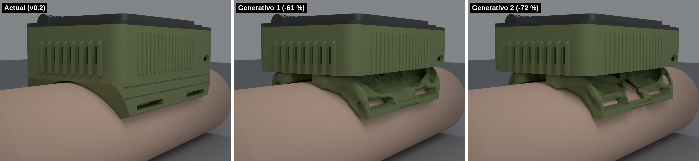
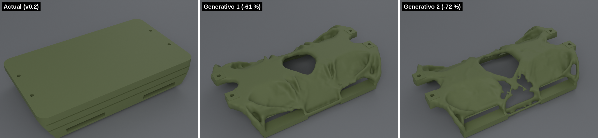
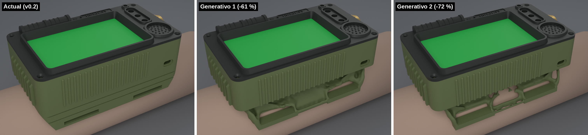

# Prueba de diseño generativo: brazalete

Prueba de optimización topológica sobre el brazalete de `cad/pipboy-zero3-v0.2.scad`, para
comparar un aspecto orgánico con el brazalete paramétrico. **Resultado: no adoptado.** El
brazalete de la v0.2 sigue siendo el de referencia.





| | Actual (v0.2) | Generativo 1 | Generativo 2 |
|---|---|---|---|
| Fracción del espacio de diseño | | 30 % | 20 % |
| Volumen | 237 cm³ | 93 cm³ (−61 %) | 65 cm³ (−72 %) |
| Masa en PETG macizo | 301 g | 118 g | 83 g |
| Rigidez: apoyado en el brazo | 1 | ×0,62 | ×0,34 |
| Rigidez: correas tensas | 1 | ×0,55 | ×0,32 |
| Rigidez: colgando de lado (izq. / der.) | 1 | ×0,46 / ×0,45 | ×0,24 / ×0,24 |
| Rigidez: deslizando a lo largo del brazo | 1 | ×0,67 | ×0,48 |
| Rigidez: cabeceo | 1 | ×0,61 | ×0,21 |
| Tensión indicativa | 1 | ×1,8 a ×2,0 | sin dato (la evaluación no dio valor) |
| Impresión | Sin soportes | Necesita soportes | Necesita soportes; hilos finos a medio formar |

- Las cargas son supuestas, no medidas: 15 N por el peso del aparato (0,5 kg × 3) y 25 N de
  tensión en cada barra de correa.
- Rigidez y tensión son proporciones sobre un modelo de vóxeles de 2 mm, no factores de
  seguridad. No se ha hecho análisis de tensiones ni prueba impresa.
- La masa se compara en macizo. Con 10-15 % de relleno el brazalete actual pesa bastante menos
  de 301 g, así que el ahorro real es menor.
- Los alojamientos de los tornillos M3 son cuadrados: la herramienta solo admite cilindros a lo
  largo de un eje, que se usó para el antebrazo.

Por qué no se adopta: las alas tienen 5 mm de grosor y el tamaño de la pieza obliga a vóxeles
de 2 mm, así que el optimizador forma láminas abultadas en vez de nervios definidos. Con menos
material aparecen huecos, pero también hilos a medio formar y entre 2 y 5 veces menos rigidez.

## Reproducir

`problems.py` describe el problema (zonas conservadas, apoyos, cargas) y queda con los ajustes
del intento 2. Las mallas (40 MB cada una) no están en el repositorio; cada intento tarda unos
25 minutos con la skill `generative-part`:

```bash
openscad -o generative/baselines/cuff.stl generative/cuff_frame.scad
sh <skill>/scripts/run.sh generative/problems.py cuff
```
