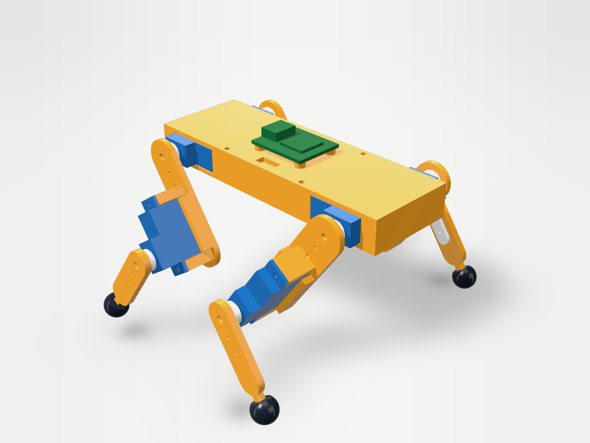
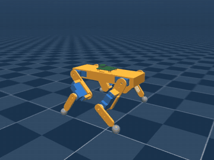
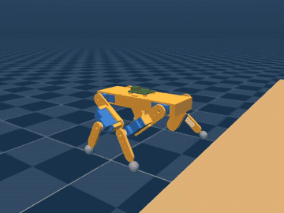

# Mini cuadrúpedo con servos de 4 g

Cuadrúpedo de bolsillo diseñado con [text-to-cad](https://github.com/earthtojake/text-to-cad)
(build123d) y probado caminando en MuJoCo. Proyecto independiente de Pip-Boy Otto; vive en esta
carpeta de forma temporal.

<p>


</p>

| | |
|---|---|
| Tamaño | 98 × 110 × 68 mm (largo × ancho × alto) |
| Masa | 85.6 g con las piezas impresas macizas (peor caso; con relleno parcial pesa menos) |
| Motores | 8 servos de ~4 g: cadera y rodilla en cada pata |
| Patas | muslo y pierna de 30 mm, pie esférico de TPU de 9 mm; rodillas hacia adentro (`> <`) |
| Batería / control | LiPo 1S 300 mAh en el chasis, placa tipo "super mini" encima |
| Piezas impresas | bandeja, tapa, 4 muslos, 4 piernas (PLA) y 4 pies (TPU): 14 piezas, 5 distintas |

## Resultado: sí funciona con servos de 4 g, y con margen

Con el servo más flojo de la clase (0.5 kg·cm y 0.12 s/60°, lo que anuncian los vendedores del
GH-S37D a 3.6 V) el robot **trota a 71 mm/s** sin caerse, y la carga media en los servos es el
**24 % de su torque máximo**. Sigue caminando con servos de 0.15 kg·cm y con 300 g de carga encima.

| Prueba (simulación, 8 s) | Resultado |
|---|---|
| Trote base (2 Hz, paso 20 mm) | 71 mm/s, cabeceo ±6°, balanceo ±5° |
| Trote rápido (4 Hz, paso 36 mm) | 179 mm/s, pero los servos piden torque máximo el 66 % del tiempo |
| Trote con pies bajos (levanta 4 mm) | 84 mm/s, cabeceo ±3°: el más suave en piso liso |
| Caminata estática, 3 apoyos (1 Hz) | 24 mm/s, cabeceo ±2° |
| Fricción del piso 0.2 a 1.2 | camina en todo el rango (55 a 72 mm/s) |
| Carga extra +60 / +300 g | camina (68 / 76 mm/s) |
| Servos de 0.3 / 0.15 / 0.1 kg·cm | camina (74 / 72 / 52 mm/s) |
| Servos de 0.03 kg·cm (prueba hecha para fallar) | no avanza: el cuerpo se hunde |
| Rampa de subida, trote | 5° sí; 10° y 15° solo inclinando el cuerpo; 20° se cae |
| Rampa de subida, caminata estática inclinada | 10°, 15° y 20° sí |
| Escalón | sube 6 mm (trote y caminata); se atasca en 8 mm |
| Giro (acortando el paso de un lado) | 20 a 50 °/s |
| Empujón lateral de 0.1 s | aguanta 1 N; con 2 N se vuelca |

Las 76 pruebas con todos sus números están en [results/RESULTS.md](results/RESULTS.md).

Videos: [trote](media/trot.mp4) · [caminata estática](media/crawl.mp4) ·
[trote subiendo un escalón de 6 mm](media/trot_step6mm.mp4). El piso tiene cuadros de 5 cm.

<p>


</p>

### Qué se aprendió

- **El torque no es el límite.** Con el pie justo debajo de la cadera, el brazo de palanca en la
  rodilla es de 17 mm y el peso se reparte entre dos patas: sobra servo.
- **El trote en lazo abierto se mece.** Con solo dos pies en diagonal el cuerpo cae hacia un pie en
  el aire hasta que este toca el piso; por eso el cabeceo es casi igual a `levantar pie / distancia
  entre patas` en todas las pruebas. Funciona, pero frena en subidas.
- **La caminata estática es lenta pero firme.** Como las patas no se mueven de lado, el peso se
  pasa adelante y atrás (±10 mm); sin ese vaivén el cuerpo se mece igual que en el trote.
- **Es ancho a propósito.** Los servos van en serie hacia afuera (cadera → muslo → rodilla → pierna),
  así que ninguna pieza puede chocar con otra en todo el recorrido de los servos.

## Lo que hay que saber antes de construirlo

- **Mide el servo real antes de imprimir.** Solo la envolvente (19.74 × 8.34 × 23.25 mm, EMAX ES9051;
  el GH-S37D de 20.05 × 8.75 × 22 mm entra en los mismos alojamientos) viene de fichas de vendedores.
  La altura de las orejas, la tapa de engranajes y la posición del eje son proporciones supuestas.
  Todo está en `src/params.py`. Por eso no se incluyen archivos STL.
- **Los datos del servo son de vendedores**, no de una hoja de datos, y no coinciden entre sí
  (0.5 a 0.8 kg·cm). La simulación usa el valor bajo.
- **El modelo del servo en simulación es estimado**, no medido: ganancia del lazo, inercia del motor
  y fricción de engranajes. No incluye holgura ni zona muerta, y las piezas son rígidas.
- **Las marchas son en lazo abierto**: sin IMU ni sensores. El rumbo deriva (hasta ~12 °/s en rampas).
- **Faltan detalles de fabricación**: ruta de cables, interruptor, tornillería. Los servos de cadera
  quedan sujetos por la tapa. Hace falta una placa con 8 salidas PWM.
- Los servos giran ±45° en el modelo (servo de 90°). Todos los ejes giran sobre +Y; en el robot real
  los servos del lado derecho van espejados y el firmware debe invertirlos.

## Comprobaciones hechas

| Qué | Cómo | Resultado |
|---|---|---|
| Ninguna pieza atraviesa a otra | `cad model interference` en 5 poses (reposo, de pie, agachado, 2 instantes del trote) | sin interferencias |
| La prueba de interferencia detecta fallos | un servo metido 1 mm en la bandeja | detectado (124 mm³) |
| Recorrido de las articulaciones | `cad model ranges`, cada una por separado | libres en la vuelta completa; el límite es el servo |
| Piezas imprimibles en FDM | `cad model dfm --process printing` en las 5 piezas | sin errores ni avisos; pared mínima 1.05 mm, ningún voladizo bajo 45° |
| Modelo de simulación sano | `cad mujoco check sim/scene.xml` | sin avisos |
| Cinemática inversa | `python3 src/gait.py` (ida y vuelta) | error < 1e-13 mm |

No se comprobó: choques entre patas con varias articulaciones a la vez en sus extremos, resistencia
de las piezas, ni nada en hardware real.

## Archivos

```
src/params.py        medidas (servo, patas, chasis)
src/parts.py         piezas: servo, horn, bandeja, tapa, muslo, pierna, pie, batería, placa
src/robot.py         ensamblaje con las 8 articulaciones y poses (home, stand, crouch, trot)
src/gait.py          cinemática inversa, trote y caminata estática (Python puro)
src/quad_mujoco.py   modelo de simulación: colisiones, servos, actuadores
src/walk_sim.py      pruebas de caminata y videos
sim/                 modelo MuJoCo generado (quad.xml, mallas) y la escena (scene.xml)
results/             resultados de las pruebas
```

## Cómo reproducirlo

Requiere text-to-cad (`sh scripts/install-text-to-cad.sh` en la raíz del repositorio).

```bash
cd quad
```

```bash
cad run src/robot.py
```

```bash
cad run src/quad_mujoco.py
```

```bash
cad run src/walk_sim.py --suite
```

Para un video hace falta una pantalla (en un servidor, `xvfb`):

```bash
xvfb-run -a env MUJOCO_GL=glfw cad run src/walk_sim.py --gait crawl --video media/crawl.mp4
```

`cad run src/robot.py` imprime el enlace al visor 3D, donde se pueden mover las articulaciones y
reproducir el trote. Para sacar archivos de impresión, con el `id` que imprime cada pieza de
`cad run src/parts.py`: `cad model export <id> STL/pieza.stl`.

## Fuentes de los datos del servo

- EMAX ES9051: [Aloft Hobbies](https://alofthobbies.com/emax-es-9051.html),
  [Motorobit](https://www.motorobit.com/emax-es9051-digital-mini-servo-motor-en)
- GH-S37D: [manual de Wishiot](https://manuals.plus/asin/B0BFQLMTGW),
  [Zbotic](https://zbotic.in/product/micro-servo-37g-gh-s37d-90-degree/)
