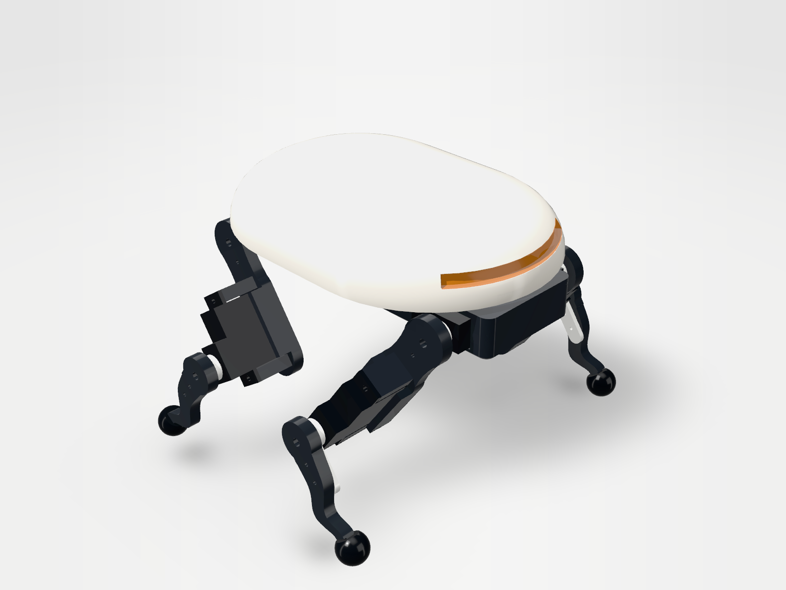
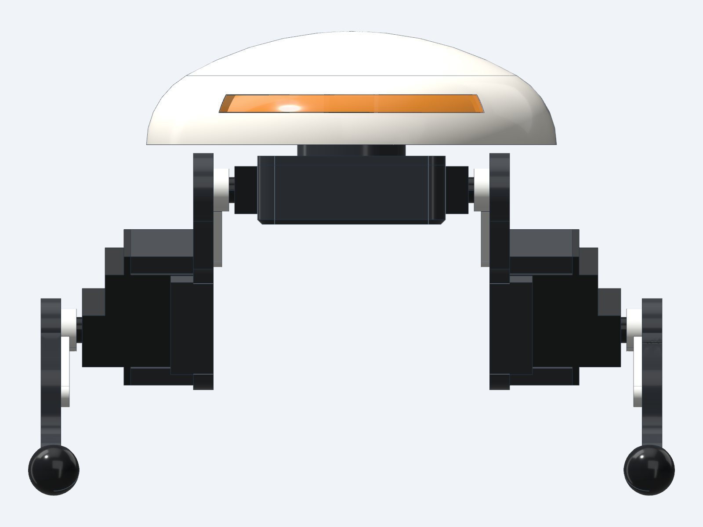
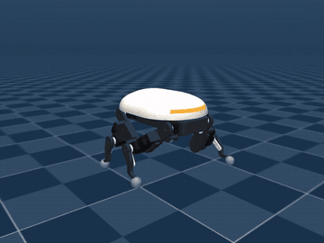
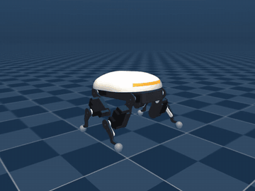
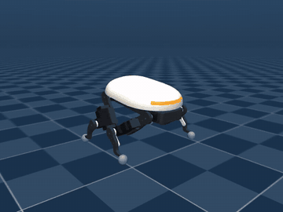

# Mini cuadrúpedo con servos de 4 g

Cuadrúpedo de bolsillo con un caparazón liso tipo piedra de río que cubre toda la mecánica y un visor
ámbar en el frente. Camina, saluda y se balancea. Diseñado con
[text-to-cad](https://github.com/earthtojake/text-to-cad) (build123d) y probado en MuJoCo. Proyecto
independiente del resto del repositorio; vive en esta carpeta de forma temporal.

<p>


</p>
<p>



</p>

Videos: [trote](media/trot.mp4) · [caminata estática](media/crawl.mp4) ·
[escalón de 6 mm](media/trot_step6mm.mp4) · [saludo](media/wave.mp4) · [balanceo](media/dance.mp4).
El piso tiene cuadros de 5 cm.

| | |
|---|---|
| Tamaño | 99 × 114 × 83 mm (largo × ancho × alto) |
| Masa | 104 g con las piezas impresas macizas (peor caso; con relleno parcial pesa menos) |
| Motores | 8 servos de ~4 g: cadera y rodilla en cada pata |
| Patas | muslo y pierna de 30 mm en placa de 3.5 mm, pierna curva, pie esférico de TPU de 9 mm; rodillas hacia adentro (`> <`) |
| Caparazón | 99 × 72 mm, 1 mm de pared, blanco mate; se quita a presión. Visor ámbar translúcido en el frente, con sitio detrás para un LED o un sensor de distancia |
| Batería / control | LiPo 1S 300 mAh en el chasis, placa tipo "super mini" bajo el caparazón |
| Piezas impresas | 18 (8 distintas): bandeja, tapa, caparazón, visor, 4 muslos, 4 piernas (2 + 2 espejadas), 4 pies de TPU |

## Qué hace (en simulación)

Con el servo más flojo de la clase (0.5 kg·cm y 0.12 s/60°, lo que anuncian los vendedores del GH-S37D
a 3.6 V), 82 pruebas de 8 s:

| Prueba | Resultado |
|---|---|
| Trote por defecto (2 Hz, paso 20 mm, pie a 5 mm) | 83 mm/s, cabeceo ±4°, carga media 22 % del torque máximo |
| Trote más rápido probado (4 Hz, paso 36 mm) | 205 mm/s, con los servos pidiendo torque máximo el 60 % del tiempo |
| Trote de paso alto (pie a 8 mm) | 66 mm/s, cabeceo ±6° |
| Caminata estática, 3 apoyos (1 Hz) | 24 mm/s, cabeceo ±2° |
| **Saludo**: se sienta hacia atrás y agita una pata delantera | la pata sube 28 mm; el cuerpo no se mueve del sitio |
| **Balanceo**: sube, baja y se mece con los cuatro pies en el piso | 6 s sin perder el equilibrio |
| Fricción del piso 0.2 a 1.2 | trota en todo el rango (83 a 89 mm/s) |
| Carga extra +60 / +300 g | trota (83 / 70 mm/s) |
| Servos de 0.3 / 0.15 / 0.1 kg·cm | trota (83 / 88 / 65 mm/s) |
| Servos de 0.03 kg·cm (prueba hecha para fallar) | no avanza |
| Rampa de subida, trote | 10° sí; 15° y 20° solo inclinando el cuerpo |
| Rampa de bajada, trote | 10° y 20° sí |
| Rampa de subida, caminata estática inclinada | 10°, 15° y 20° sí |
| Escalón | 4 mm con el pie a 8 mm; 6 mm con el pie a 14 mm o con la caminata estática; se atasca en 8 mm |
| Giro (acortando el paso de un lado) | 26 a 41 °/s |
| Empujón lateral de 0.1 s | aguanta 2 N; con 4 N se vuelca |

Todos los números: [results/RESULTS.md](results/RESULTS.md).

## ¿Aguantan las patas y los servos?

**Los servos, sí, con margen.** Sostener el robot en trote pide en la rodilla unos 0.0085 N·m
(0.5 N por pie × 17 mm), el 17 % del torque máximo de un servo de 0.5 kg·cm; en movimiento la carga
media es el 22 %. Sigue trotando con servos de 0.1 kg·cm y con 300 g encima.

**Las patas, sí para caminar; no para caídas.** Se midió la fuerza en cada pie en simulación
(`src/foot_loads.py`) y se analizó una pata completa con esas fuerzas por elementos finitos
(`src/leg_study.py`, casos en `fea/`): cuerno, muslo, servo de rodilla y pierna, con la rodilla
bloqueada. La primera versión (placas de 2 y 2.5 mm) **no pasaba**: el muslo cedía a 10 N en el pie.
Se reforzó a 3.5 mm y se quitó un agujero de tornillo de la zona más cargada.

| Situación | Fuerza máxima en un pie | Factor de seguridad del muslo (la pieza impresa más cargada) |
|---|---|---|
| Parado | 0.25 N | más de 40 |
| Trote por defecto, el 99 % del tiempo | hasta 1.4 N | 9 |
| Trote por defecto, peor pico | 3.9 N y 2.1 N de lado | 3.2 |
| Caminata estática, peor pico | 2.3 N | 5.5 |
| Trote más rápido (4 Hz, 36 mm), peor pico | 8.6 N y 3.5 N de lado | 1.5 |
| Caída de 5 cm sobre las patas | 12 N | 2.0 |
| Caída de 10 cm sobre las patas | 18 N | 1.4 |

El factor es el límite elástico del PLA (45 MPa) entre el esfuerzo máximo. Por debajo de 2 no hay
margen para lo que el análisis no ve.

Lo que el análisis **no** puede asegurar:

- **El eje de salida de los servos de cadera.** La pata cuelga de lado de ese eje, a ~29 mm, y la
  fuerza del pie lo dobla. No se pudo modelar (no se conoce su material ni su apoyo interno). Una
  estimación como barra de 4.6 mm da unos 22 MPa en el peor pico del trote por defecto y más de 55 MPa
  en una caída de 10 cm. Es el punto más débil probable del robot real.
- **Golpes y fatiga.** Es un análisis estático y lineal. Las fuerzas de impacto vienen de una
  simulación con contacto rígido: en el robot real el pie de TPU y la holgura de los engranajes las
  suavizan, pero no se sabe cuánto.
- **Las uniones.** Los tornillos y cuernos se toman como pegados. Una pieza impresa aguanta menos entre
  capas que a lo largo; aquí las placas trabajan a lo largo de las capas.

En resumen: caminar y hacer los movimientos está dentro de lo que aguanta; el trote más rápido va justo;
conviene no dejarlo caer de más de unos centímetros.

### Qué se aprendió

- **El torque no es el límite.** Con el pie debajo de la cadera, el brazo de palanca en la rodilla es
  de 17 mm y el peso se reparte entre dos patas.
- **La fuerza de lado sí lo es.** Las patas salen hacia afuera en voladizo, así que cada apoyo dobla el
  muslo y el eje del servo de cadera. Es lo que decide el grosor de las placas.
- **El trote en lazo abierto se mece**: con dos pies en diagonal el cuerpo cae hacia un pie en el aire.
  Levantar poco el pie (5 mm) lo mantiene suave.
- **Las patas de un mismo lado pueden chocar entre sí** si las dos caderas giran más de ~25° hacia
  adentro a la vez. Las marchas no llegan ahí y `gait.legs_clear()` lo vigila en cada orden a los servos.

## Lo que hay que saber antes de construirlo

- **Mide el servo real antes de imprimir.** Solo la envolvente (19.74 × 8.34 × 23.25 mm, EMAX ES9051;
  el GH-S37D de 20.05 × 8.75 × 22 mm entra en los mismos alojamientos) viene de fichas de vendedores.
  La altura de las orejas, la tapa de engranajes y la posición del eje son proporciones supuestas.
  Todo está en `src/params.py`. Por eso no se incluyen archivos STL.
- **El caparazón necesita soportes por dentro.** Es una cúpula baja: se imprime con el borde hacia
  abajo y el techo (25 % de su superficie) queda en voladizo. Los soportes van dentro, donde no se ven.
  El resto de las piezas se imprime sin soportes; el visor, en PETG translúcido.
- **Los datos del servo son de vendedores**, no de una hoja de datos, y no coinciden entre sí
  (0.5 a 0.8 kg·cm). La simulación usa el valor bajo.
- **El modelo del servo en simulación es estimado**, no medido: ganancia del lazo, inercia del motor
  y fricción de engranajes. No incluye holgura ni zona muerta, y las piezas son rígidas.
- **Todo es en lazo abierto**: sin IMU ni sensores.
- **Faltan detalles de fabricación**: ruta de cables, interruptor, tornillería. El visor va pegado en
  su ranura. Hace falta una placa con 8 salidas PWM.
- Los servos giran ±45° en el modelo (servo de 90°). Todos los ejes giran sobre +Y; en el robot real
  los servos del lado derecho van espejados y el firmware debe invertirlos.

## Comprobaciones hechas

| Qué | Cómo | Resultado |
|---|---|---|
| Ninguna pieza atraviesa a otra en los movimientos | `cad model interference` en 51 poses: de pie, agachado y a lo largo del trote, la caminata, el saludo y el balanceo | sin interferencias |
| La prueba de interferencia detecta fallos | un servo metido 1 mm en la bandeja | detectado (124 mm³) |
| Poses extremas | las dos caderas de un lado a 25°–45° hacia adentro | las patas chocan entre sí desde 25°–30°, según las rodillas |
| El vigilante de choques entre patas | `python3 src/check_guard.py <id>`: 40 poses al azar contra el CAD | 10 chocan y las rechaza todas; rechaza además 2 que no chocan |
| Recorrido de las articulaciones | `cad model ranges`, cada una por separado | rodillas libres; caderas de −154° a +60° (tope: el caparazón), más que los ±45° del servo |
| Piezas imprimibles en FDM | `cad model dfm --process printing` en las 8 piezas | 6 sin avisos; el caparazón con avisos de voladizo (techo y ranura del visor); el visor con un aviso (sus puntas salen redondeadas) |
| Esfuerzos en una pata | `cad model solve` (netgen + CalculiX), 3 casos con 10 N en el pie | sin empuje lateral, todas las piezas impresas con factor ≥ 2.5; con 5 N de lado, muslo 1.3 y pierna 1.9 |
| Modelo de simulación sano | `cad mujoco check sim/scene.xml` | sin avisos |
| Cinemática y movimientos | `python3 src/gait.py` | error < 1e-13 mm; los 4 movimientos dentro de ±45° y sin acercar las patas |

No se comprobó: el ajuste a presión del caparazón, el encaje del visor, el eje de los servos de
cadera, ni nada en hardware real.

## Archivos

```
src/params.py        medidas (servo, patas, chasis)
src/parts.py         piezas: servo, horn, bandeja, tapa, muslo, piernas, pie, caparazón, visor
src/robot.py         ensamblaje con las 8 articulaciones, poses y movimientos
src/gait.py          cinemática inversa, trote, caminata, saludo, balanceo y vigilante de choques (Python puro)
src/check_guard.py   compara el vigilante de choques con el CAD
src/quad_mujoco.py   modelo de simulación: colisiones, servos, actuadores
src/walk_sim.py      pruebas y videos
src/foot_loads.py    fuerzas máximas en los pies (marchas y caídas)
src/leg_study.py     modelo de una pata para el análisis de esfuerzos
fea/                 los 3 casos de carga y sus resultados
sim/                 modelo MuJoCo generado (quad.xml, mallas) y la escena (scene.xml)
results/             resultados de las pruebas
```

## Cómo reproducirlo

Requiere text-to-cad (`sh scripts/install-text-to-cad.sh` en la raíz del repositorio).

```bash
cd quad
```

```bash
cad run src/robot.py
```

```bash
cad run src/quad_mujoco.py
```

```bash
cad run src/walk_sim.py --suite
```

Un movimiento suelto (`trot`, `crawl`, `wave` o `dance`), con video; hace falta una pantalla (en un
servidor, `xvfb`):

```bash
xvfb-run -a env MUJOCO_GL=glfw cad run src/walk_sim.py --gait wave --video media/wave.mp4
```

`cad run src/robot.py` imprime el enlace al visor 3D, donde se pueden mover las articulaciones y
reproducir los cuatro movimientos. Para sacar archivos de impresión, con el `id` que imprime cada
pieza de `cad run src/parts.py`: `cad model export <id> STL/pieza.stl`.

## Fuentes de los datos del servo

- EMAX ES9051: [Aloft Hobbies](https://alofthobbies.com/emax-es-9051.html),
  [Motorobit](https://www.motorobit.com/emax-es9051-digital-mini-servo-motor-en)
- GH-S37D: [manual de Wishiot](https://manuals.plus/asin/B0BFQLMTGW),
  [Zbotic](https://zbotic.in/product/micro-servo-37g-gh-s37d-90-degree/)
